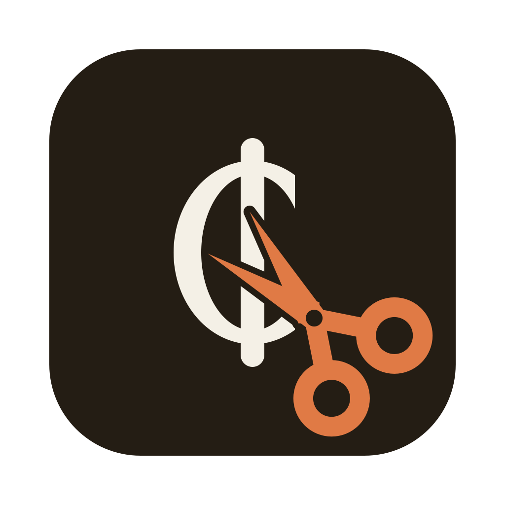

<p align="center">
  
</p>

<h1 align="center">Copyisto Trimmer</h1>

<p align="center">
  Cut the music out of scanned notebooks, one box at a time.<br>
  <a href="https://github.com/copyisto/copyisto-trimmer/releases/latest/download/Copyisto-Trimmer.zip"><b>Download for macOS</b></a>
</p>

Open a submission's folder, draw boxes around the staves you want, and export every box as its own image.
It is built for the [Copyisto](https://copyisto.com) dataset of handwritten harmony exercises, but works on any folder of PNG or JPG pages.

## Download

1. Download [Copyisto-Trimmer.zip](https://github.com/copyisto/copyisto-trimmer/releases/latest/download/Copyisto-Trimmer.zip) from the latest release.
2. Unzip it and drag **Copyisto Trimmer** into Applications.

Requires macOS 26, on Apple silicon or Intel.

## Use

1. Open a submission's folder (⌘O) or drop it onto the window; a single notebook or any folder of scans works too.
2. If a page is tilted, press **Wyprostuj automatycznie** (⌘L), or turn it by 0.1° with `[` and `]`.
3. Drag on a page to draw a box; drag a box to move it, or its handles to resize it.
4. Describe crops in the panel on the right (⌥⌘I): tags and a note for the selected box (⌘T, ⌘U), its page (⇧⌘T, ⇧⌘U) and its notebook (⌃⌘T).
5. Press **Eksportuj** (⌘E).

Each notebook keeps its boxes in its own `trims.copyisto.json` and gets its crops in its own `trims.copyisto/`, named `<page>_001.png`, `<page>_002.png`, …, at the scan's full resolution.
Crops of a turned page are cut from the turned page, so the staff lines in them come out level.
Boxes are saved as you go, so you can close the app and carry on later; it reopens the last folder on the page you left.
Export cuts only the notebooks whose boxes changed since their last export, and says which.
Every action is a toolbar button, with its shortcut in the tooltip.
The `.copyisto` suffix marks Copyisto's files; files named `copyisto-trims.json` and folders named `copyisto-trims/` by older builds are renamed when a folder opens.

Export PNG: the dataset wants lossless crops, and the app warns while JPG is selected.

## Submissions

The [Copyisto CLI](https://github.com/copyisto/copyisto-ingestor) works on a whole submission like git on a repository:

```sh
copyisto init M4K-V && cd M4K-V && copyisto pull
copyisto describe --device-type scanner --device "Epson DS-70000"
# Copyisto Trimmer: open M4K-V, boxes, tags, notes, export (⌘E)
copyisto status
copyisto push
```

```
M4K-V/
  .copyisto/            the CLI's state, the description (description.json) and the tags in use (tags.json)
  01/                   notebook M4K-V-01: scans, trims.copyisto.json, trims.copyisto/
  nowy/                 a new notebook; copyisto push gives it a number and renames the folder
```

The window is titled with the submission's code, and the list has a foldable section per notebook, in the order of their numbers, with new ones last.
Files at the top of the submission belong to no notebook, so the list names them once instead of showing them as scans.
A notebook folder opened on its own is that one notebook, titled with its ID, such as M4K-V-01.
The app looks for `.copyisto/state.json` in the opened folder and its parent only, and reads nothing from it but the code.
It watches the folder, so pages and notebooks from `copyisto pull` appear, and a notebook renamed by `copyisto push` keeps its selection.

## Tags and notes

In a tag field, Return or a comma adds a tag and Backspace in the empty field removes the last one.
Tags are lowercase with single spaces, 1 to 50 characters, exactly as the server stores them, and the field shows them that way as you type.
Suggestions come from the tags already used in the open notebooks and from the server's list: `.copyisto/tags.json`, or in a notebook folder from older CLIs `.tags.copyisto.json`, then `.copyisto-tags.json`; the first that exists is used, and the app only reads it.
A box shows the tags it inherits greyed out, in the order the CLI joins them: the file's description, the notebook's and the page's tags from `trims.copyisto.json`, then its own.
Its number on the page gets an icon when the box has its own tags or note, and turns into a warning when its crop would have more than 20 tags, which the CLI refuses.
A crop's note is the file's note from the description, the page note and the box note, one per line, within 2000 characters, counted under each note.

In a submission, the panel also edits the shared description, `.copyisto/description.json`, as `copyisto describe` does:

- **Plik w opisie zgłoszenia**: what the scan was taken with (device type, model, dpi), its tags and its note, inherited by its crops.
- **Zeszyt**: the notebook's tags and its note, which is about the notebook and goes to no crop.
- **Zgłoszenie**: what is set for the whole submission, shown only; it is changed with `copyisto describe`.

A file's description is the submission's, then its notebook's, then its own: tags joined, the source field by field, except that another device type starts it over, so a phone photo does not get the scanner's model.
A notebook without a number has no part in the description until `copyisto push` gives it one, so its fields are disabled until then.
The app writes only the fields you change, leaves out emptied ones, and keeps every key it does not know and every other notebook's part.
It reads the file again before each write; if the same field changed there in the meantime, for example by `copyisto pull`, it asks which value to keep.
Nothing reaches the server until `copyisto push`.
It never writes anything else in `.copyisto/` or the CLI's hidden files.

## Copyisto Labs without the terminal

**Copyisto Labs** in the toolbar (⇧⌘E) runs the same CLI for you, so it has to be installed and signed in (`copyisto login`, or **Zaloguj** in that window).
It shows who you are signed in as (`copyisto whoami`), and pulls a submission by its code into `~/Trimmer/<code>` (`copyisto init`, then `copyisto pull`) and opens it; a notebook's code pulls only that notebook.
In an open submission, **Pobierz zmiany** runs `copyisto pull`, and **Eksportuj i wyślij** exports the changed notebooks and runs `copyisto push`.
When the push would ask something, such as whether to make a new notebook or replace someone else's newer version, nothing is sent: the window shows the question, and **Potwierdź i wyślij** runs `copyisto push --force`.
The CLI's output shows in the window, refusals included.
The app looks for `copyisto` in `~/.bun/bin`, `/opt/homebrew/bin`, `/usr/local/bin` and the inherited `PATH`.

## Build

You need Xcode 26.

```sh
git clone git@github.com:copyisto/copyisto-trimmer.git
cd copyisto-trimmer
scripts/bundle.sh
open "build/Copyisto Trimmer.app"
```

`swift test` runs the tests, and `swift run` starts the app without bundling it (no icon, system fonts).

## Release

Push a tag and GitHub Actions builds, signs, notarises and publishes the app:

```sh
git tag v0.2.0
git push origin v0.2.0
```

Signing needs these repository secrets; without them the build is ad hoc signed and macOS will ask before opening it.

| Secret | What it is |
|---|---|
| `MACOS_CERTIFICATE` | The Developer ID Application certificate as a base64 `.p12` |
| `MACOS_CERTIFICATE_PASSWORD` | The `.p12` password |
| `NOTARY_KEY` | An App Store Connect API key as a base64 `.p8` |
| `NOTARY_KEY_ID` | That key's ID |
| `NOTARY_ISSUER_ID` | The App Store Connect issuer ID |

## How it works

`trims.copyisto.json` stores a notebook's boxes in pixels of the original scan, like labelme:

```json
{
  "version": 3,
  "tags": ["zeszyt a5"],
  "images": {
    "4H8-E_001.png": {
      "width": 4960, "height": 7016,
      "rotation": -0.46,
      "tags": ["polifonia"],
      "note": "strona przekreślona",
      "boxes": [
        { "id": 1, "x": 120, "y": 840, "width": 4700, "height": 1300, "tags": ["monodia"], "note": "takt 3 nieczytelny" },
        { "id": 2, "x": 120, "y": 2300, "width": 4700, "height": 1300 }
      ]
    }
  }
}
```

`rotation` is in degrees clockwise about the page centre, and the boxes are in pixels of the turned page, which keeps the original size and has white in the uncovered corners.
Straightening finds the angle by projection profile, the deskew method of Leptonica and Tesseract: turned level, the staff lines fall into the fewest rows.
`tags` on the file apply to every crop of the notebook, on an image to each crop from it, on a box to its crop only; `note` works the same on images and boxes.
Empty tags and notes are left out, as `rotation` is on a level page.
Every new field bumps `version`, because a build that does not know a field would drop it on save; older builds refuse newer files instead.
Boxes are numbered in the order they were drawn, and deleting one renumbers the rest, so label crops only once a page's boxes are final.
Each export of a notebook rewrites its crops and removes its own crops whose box is gone; other files in `trims.copyisto/` are left alone.
The app has no dependencies beyond the macOS SDK and makes no network requests itself; Copyisto Labs goes through the `copyisto` CLI.

## Licence

[MIT](LICENSE).
The bundled fonts, [Young Serif](https://github.com/noirblancrouge/YoungSerif) and [Archivo](https://github.com/Omnibus-Type/Archivo), are under the SIL Open Font License (`Resources/Fonts/*-OFL.txt`).
